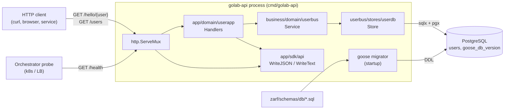
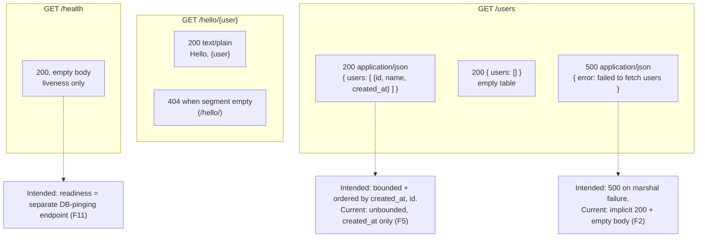
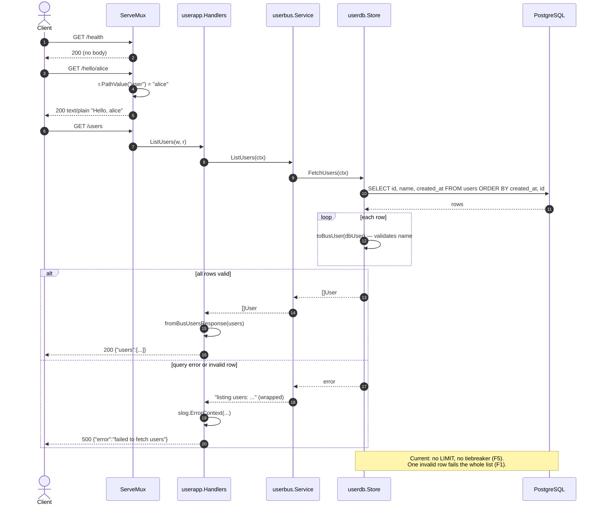
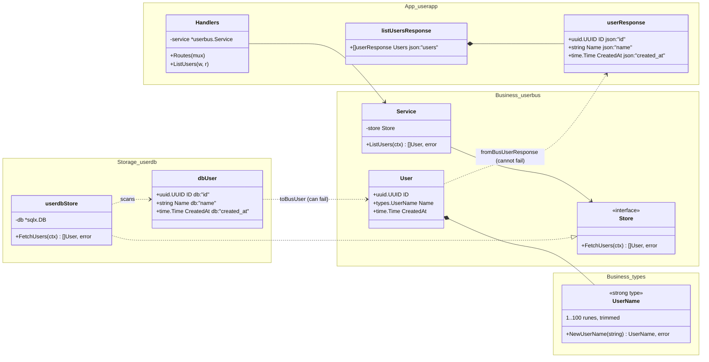
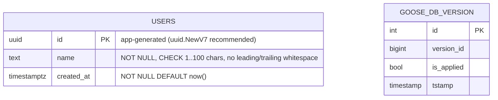
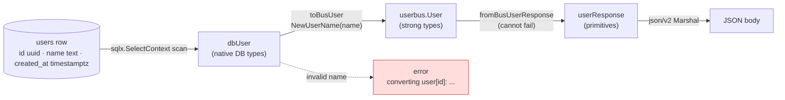
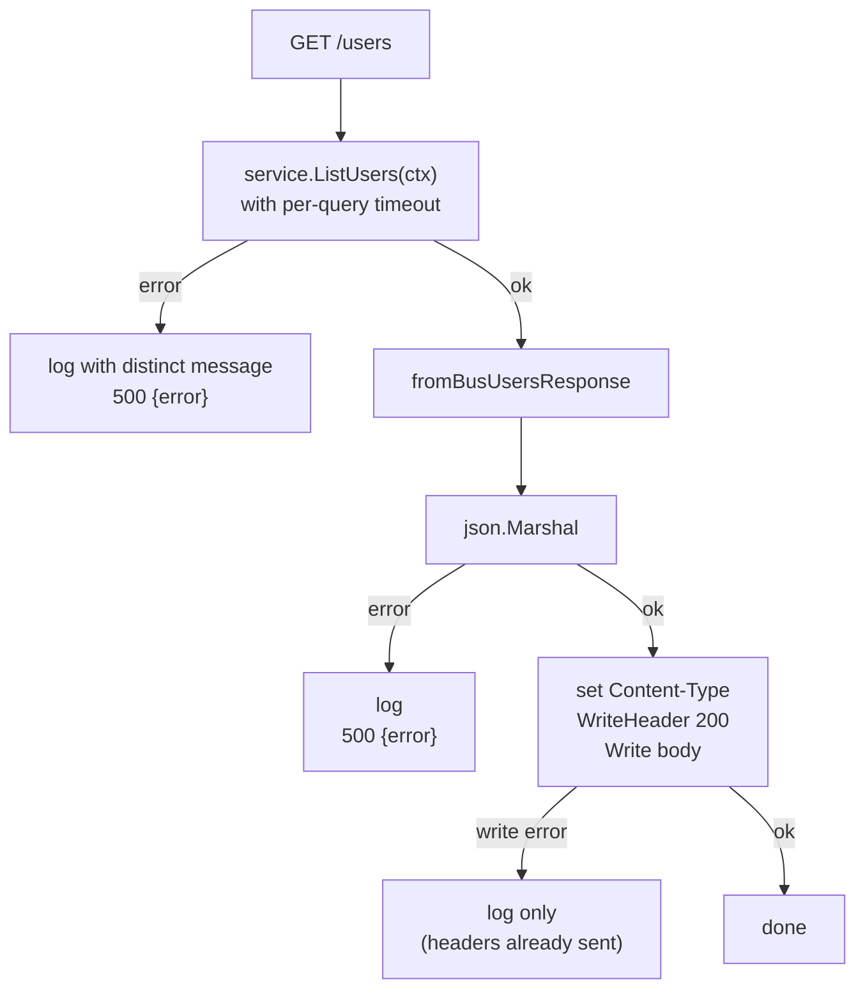
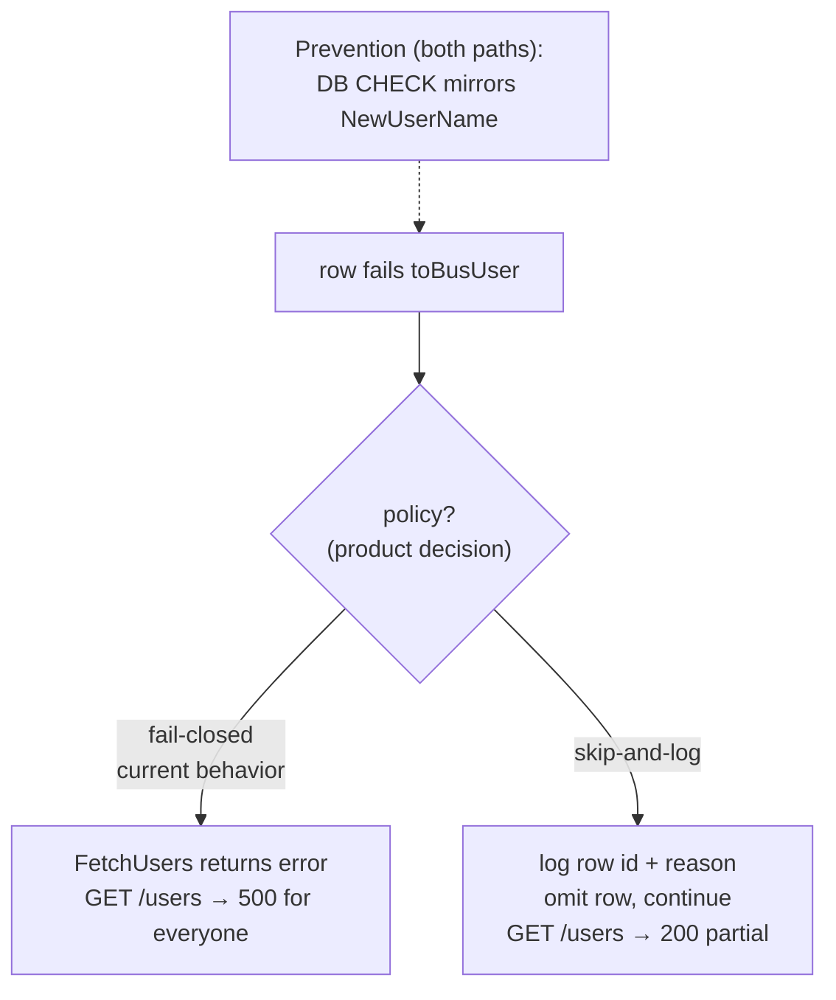
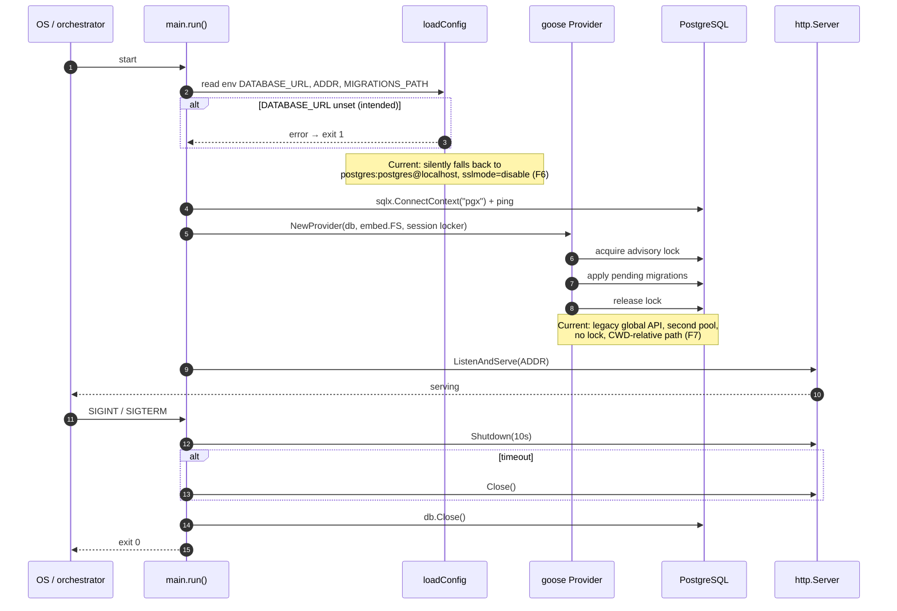

# ABC-1234 — Feature Diagrams

How the golab API (health, hello, list users) **should** work. Each diagram depicts intended behavior; where the code at `4eee246` diverges, the divergence is called out with the finding id from `finding.md` (e.g. **F1**).

## 1. System context

## 2. Client-facing HTTP contract

## 3. Client interaction — sequence

## 4. Data types across layers

Notes:
- `UserName` should be opaque (struct with unexported field) so only `NewUserName` can construct it; it is currently `type UserName string` (**F4**).
- Converter names should be `toBusUser` (Storage) and `fromBusUserResponse` (App, per item) (**F10**).
- Whether `uuid.UUID` / `time.Time` count as edge primitives in `userResponse` is an open team decision (**F10**).

## 5. Persistence model

Intended index: `(created_at, id)` to back ordering/pagination. Current migration has no CHECK on `name` (**F1**), no index (**F5**), and uses `IF NOT EXISTS` (**F8**).

## 6. Type-boundary crossings (read path)

Crossing *into* Business can fail (validation); crossing *out* cannot. Serialization (`json.Marshal`) can still fail and must surface as 500, not 200 (**F2**).

## 7. `GET /users` — handler decision flow

## 8. Corrupt-row policy (decision required)

## 9. Startup and shutdown lifecycle

